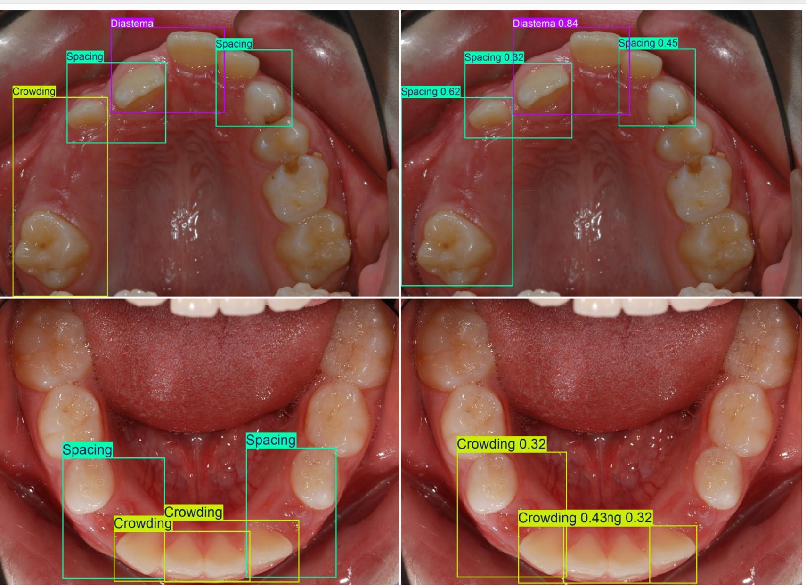

# AI 口腔扫描工作台

这是一个个人项目，想把口腔影像采集和识别结果放进一个直观、易浏览的工作台里。项目目前以产品展示和交互演示为主，重点呈现二维口腔照片的扫描与结果查看流程。



## 可以看到什么

- **二维影像展示**：查看口腔照片上的区域标记和识别结果示例。
- **多种采集入口**：通过图片上传、浏览器摄像头或导入三维模型开始体验工作流程。
- **结果与档案页面**：浏览分析、检查记录和报告页面，了解这些信息如何组织在一起。
- **三维模型预览**：导入 STL、OBJ 或 PLY 文件，查看模型和基础几何信息。

扫描工作台中的动画和结果卡片用于展示交互流程。仓库已经上传 `best.onnx` 模型文件，但目前还没有接入网站推理；页面展示的检测画面是示例，不是网站对当前照片运行模型后得到的结果。

## 项目状态

这是一个用于展示和学习的个人项目，不是医疗产品。页面内容不能用于诊断或代替专业医生的判断。模型推理尚未接入，三维几何信息也不代表疾病结论。

## 在本地体验

需要 Python 3、Node.js 22 及 pnpm。先在一个 PowerShell 窗口启动后端：

```powershell
cd backend
python -m venv .venv
.\.venv\Scripts\python.exe -m pip install -r requirements.txt
.\.venv\Scripts\python.exe -m uvicorn app.main:app --host 127.0.0.1 --port 8000
```

再打开另一个 PowerShell 窗口启动前端：

```powershell
cd frontend
pnpm install
pnpm dev
```

打开前端终端显示的本地网址即可。摄像头采集需要浏览器授权；保存检查、上传文件等功能需要后端保持运行。

## 想了解实现细节？

- [系统架构](docs/ARCHITECTURE.md)
- [模型接入说明](docs/MODEL_INTEGRATION.md)
- [三维几何分析说明](docs/GEOMETRY_ANALYSIS.md)
- [API 设计](docs/API_DESIGN.md)

