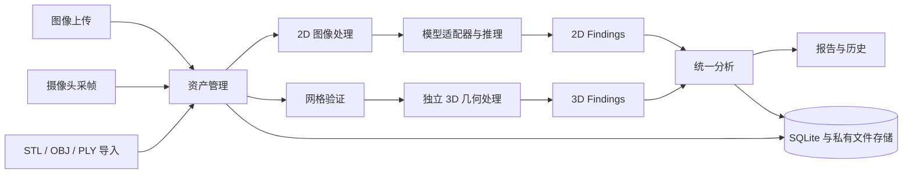

# AI OralScan 架构设计（Phase 0）

状态：方案草案，待验收；尚无业务实现。用于辅助筛查和研究，不构成独立诊断。当前没有专业口腔扫描仪，先使用图像、浏览器摄像头和本地三维文件。

## 流程与边界



采集层只负责获取和验证输入；资产层负责原件、派生文件和元数据；二维处理、推理、三维处理、统一分析、报告、持久化各自隔离。统一分析以资产 ID 汇总状态、证据和限制，部分失败不丢失其他结果。无经过确认的口腔模型时返回 `MODEL_NOT_CONFIGURED`，不把 COCO 类别解释成疾病；置信度不是患病概率。演示或测试数据须显式标记 DEMO。

二维位置为指定资产、指定方向处理版本的图像像素坐标，记录原点、尺寸及模型输入到原图的变换。三维位置采用指定资产原始 mesh 坐标或顶点/面索引，记录坐标系、单位、变换和网格版本。两者不共享坐标系，也不声称配准。单位未知即为 unknown；几何异常不等于疾病。

## 参考程序审查

`reference/object_detect_yolov8n.py` 为 CanMV K230 板端程序。`libs.PipeLine`、`AIBase`、`AI2D`、`media.*`、`nncase_runtime`、`ulab`、`image`、`aidemo` 等依赖设备固件或板端环境，不能当作桌面 Python 依赖照搬。模型位于板端 `/sdcard/examples/kmodel/yolov8n_320.kmodel`，仓库未提供该模型。

程序配置 320×320、NCHW uint8，使用 half-pixel 双线性直接 resize；宽高分别缩放，不保持比例。其代码将 `results[0]` 按前三维 reshape 后转置，假定行是候选框、前四列是中心点 x/y、宽高、其余列是类别分数；对类别分数取最大值和索引，没有显式 objectness 相乘。**这只是代码假设，不是对实际模型张量的验证**：缺少模型与运行时输出，维度、数值范围、量化、归一化和输出语义都须通过真实模型元数据及样本验证。

框解码为 `(x±w/2, y±h/2)` 后乘独立 x/y 缩放，显示时再映射到屏幕。示例全局置信度和 NMS 阈值均为 0.2，最多 50 框；构造器默认分别为 0.5、0.2，但后处理错误引用全局 `confidence_threshold` 与 `nms_threshold` 而非实例字段。NMS 没按类别分组，不同类别可互相抑制；`uint8` 保存排序索引可在候选数大于 256 时溢出。面积采用含 `+1` 的像素约定；未显式处理无效坐标、裁剪和非有限数。`if dets` 对标准 NumPy 多元素数组可能产生真值歧义；实际 ulab 行为需在目标环境验证。

可迁移思路：按模型契约预处理、候选解码、分数筛选、类别感知 NMS、可逆坐标映射和覆盖绘制。必须重写硬件采集、推理运行时、显示及后处理，并验证模型版本、输出和训练预处理；不得默认所有 YOLO 使用同一输出格式。对空输出、类别、边界、浮点异常、索引和不同宽高图测试。

## 拟议目录

```text
AI-OralScan/
  reference/                 # 原始参考，不改写
  frontend/src/{app,components,features,lib}/
  frontend/tests/
  backend/app/{api,acquisition,assets,image_processing,inference,geometry,analysis,reports,persistence}/
  backend/tests/{unit,integration,fixtures/meshes}/
  docs/                       # 设计与进度
  README.md
  .gitignore
```

括号表示未来目录，不是已创建文件。服务端只通过受控 API 访问私有存储，原件与派生物分开；上传做内容、大小及路径校验。OBJ 外部引用默认禁止，解析资源量及时间受限。摄像头权限由浏览器管理，离开页面停止轨道。界面优先清晰卡片、状态与响应式布局，避免复制参考产品品牌。用户提供的网站通过网页读取工具不可访问；本机 Edge 控制接口也未连接，具体页面布局尚未核实，后续需实际查看。
