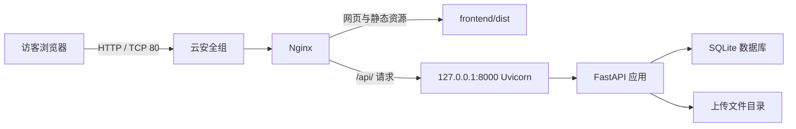

# 03 · 网络服务基础

## 1. 用户访问时发生了什么

浏览器先获取 HTML、CSS、JavaScript，再按页面操作发送 API 请求。Nginx 是统一入口，后端负责保存和查询等逻辑。数据库文件本身不应暴露为网页下载资源。

## 2. 地址与端口

| 名称 | 含义 |
| --- | --- |
| 公网 IP | 外部网络用于定位服务器的地址 |
| 私网 IP | 云内网络地址，不能直接当作互联网网站链接 |
| `127.0.0.1` | 当前机器自己；在访客电脑上就是访客电脑，不是云服务器 |
| 端口 | 同一台机器上区分不同网络服务的编号 |
| `0.0.0.0` 监听 | 服务监听所有 IPv4 网卡地址，不是分享给用户的地址 |
| 安全组来源 `0.0.0.0/0` | 匹配所有 IPv4 来源；仍受该条规则的协议/端口限制 |

本次 80 用于网页 HTTP，8000 仅在服务器内部接收 Nginx 转发。22 常用于 SSH 管理；443 常用于 HTTPS。本次不需要向公网开放 8000，也没有因为使用 VNC 而自动开放 SSH。

安全组解决“连接是否允许到达”，监听服务解决“谁接收连接”，应用权限解决“访客能做什么”。开了端口不等于程序已运行，关闭管理网页也不等于停止程序。

## 3. HTTP、HTTPS 与浏览器限制

HTTP 是浏览器与服务器交换内容的协议。HTTPS 在 HTTP 外增加 TLS 加密和服务器身份验证。把地址里的 `http` 改成 `https` 不会自动给服务器安装证书或启用 HTTPS。

本次只配置了 HTTP 入口。先前一次无法访问，用户确认与访问协议有关；仅凭 `ERR_CONNECTION_CLOSED` 本身不能断言根因，因为网络设备、代理和服务端都可能终止连接。

公网 HTTP 页面中部分浏览器能力受限：`crypto.randomUUID()` 需要安全上下文；摄像头接口也要求安全上下文及用户授权。localhost 在开发环境中有特殊信任规则，不能据此推断公网 HTTP 同样可用。[UUID 文档](https://developer.mozilla.org/en-US/docs/Web/API/Crypto/randomUUID)、[摄像头文档](https://developer.mozilla.org/en-US/docs/Web/API/MediaDevices/getUserMedia)

兼容 UUID 的代码补丁不等于建立了加密连接。后续 HTTPS 需要单独配置可信证书、Nginx TLS 入口，并允许对应端口。域名/DNS 与证书是关联但不同的配置；具体上线要求应在实施时查阅服务商最新说明。

## 4. 反向代理、同源与前端路由

反向代理让访客只访问 Nginx，由 Nginx 转交 API 请求。前端请求相对路径 `/api/...` 时，与网页保持相同协议、主机、端口，可减少跨源配置需求。开发服务器中的 Vite proxy 不会随静态构建自动变成线上代理，因此生产环境另配 Nginx。[Nginx 入门文档](https://nginx.org/en/docs/beginners_guide.html)

单页应用的某些路径由浏览器中的 JavaScript 处理。刷新该路径时，Nginx 用 `try_files` 回退到 `index.html`；API 则必须交给 `/api/` 的代理规则，不能把 API 错误误当作 HTML 页面返回。

## 5. 响应与排错层次

| 现象 | 可优先检查什么 |
| --- | --- |
| 连接超时或连接被关闭 | 协议、云实例状态、安全组、监听端口、客户端代理/网络 |
| 200 | 请求成功返回；仍需检查返回内容是否符合预期 |
| 404 | 地址路径不匹配或资源不存在 |
| 413 | 请求体超出代理或应用上限 |
| 502 | 代理无法正常取得后端响应，检查后端服务和日志 |
| 500 | 应用处理失败，查看后端异常日志 |
| 页面打开、上传报错 | 浏览器代码、API 请求、文件校验或后端处理都可能相关 |

先请求服务器本机后端，再请求本机 Nginx，最后从外部网络访问。这样能分清故障发生在哪一段。手机关闭 Wi-Fi 后测试，是检查另一条访问网络的简便方式。

## 6. 数据与多人访问

GitHub 保存源码；云端 SQLite 保存业务记录；上传目录保存文件；浏览器显示结果。这些不是同一份存储。

GitHub 提交变化不会自行进入服务器，除非专门建立自动部署。源码更新也不意味着应该清空数据库。当前演示模式没有经本次部署验证的用户隔离能力：公开网页不等于每个访客拥有独立私有空间。分享测试应使用演示资料；上线真实业务前需验证认证、授权和数据隔离。
